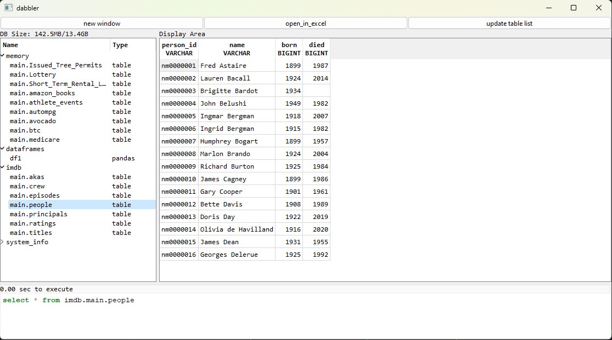
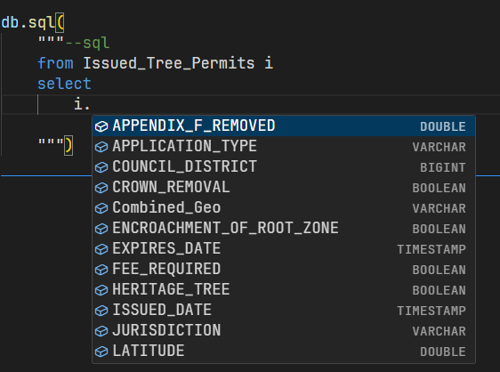
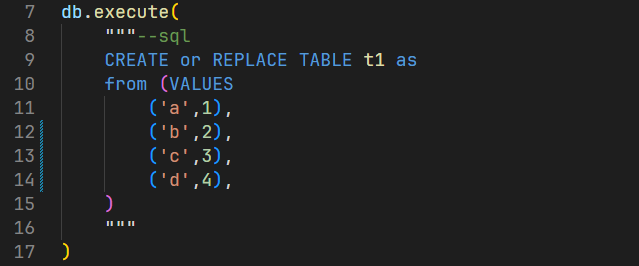

# dabbler
An IPython extension and SQL language server for DuckDB SQL written inside python files. A VS Code extension starts the language server. This project is a work in progress and there are still some bugs.

Table/Query browser:



Intellisense / autocomplete:



### Features:
- A window to view tables and query results from your IPython session, with search and filtering, cancelable queries, and export to CSV, Parquet or Excel
- Auto completion for:
    - ✔️tables, views, schemas and databases
        - including tables and views the file's own SQL creates (`CREATE TABLE t (...)`, `CREATE OR REPLACE TABLE t AS SELECT ...`), before they've been run
    - ✔️columns
        - for tables, views, CTEs, subqueries, table functions such as `read_csv('x.csv')`, `VALUES` lists and table macros
        - select-list aliases, where DuckDB lets you reuse them
    - ✔️functions, with signature help and docs on hover
    - ✔️file paths in SQL strings (`FROM '...'`, `read_csv('...')`, `COPY ... TO '...'`) and `pathlib.Path` variables
    - ✔️keywords, settings (`SET threads`), types (after `::`), and extensions (`LOAD ...`)
- Syntax errors from DuckDB's own parser
- Format the SQL string under the cursor (command: "dabbler: Format current sql statement")
- Completions from a DuckDB database file without an IPython session (`# dabbler use '<file>'`, see below)
- Send/Execute the SQL query under the cursor from the editor to the dabbler window

### Current Limitations
- Completions work in `.py` files, not in notebook (`.ipynb`) cells.
- The completion grammar parses most DuckDB SQL (about 98% of the statements in DuckDB's own test suite); where it can't, completions fall back to simpler text patterns. `plan.md` lists the known gaps.
- Tables in schemas on `search_path` (other than the current one) aren't offered by their name alone.
- In f-strings, `{fields}` are treated as names, and f-strings with fields aren't checked for syntax errors, since what the fields expand to isn't known.


### Install / Setup
#### Prerequisites
- Install VSCode
- Install Python VScode Extension
- Install Jupyter VScode Extension (for the Interactive Window)
#### Install dabbler
- `pip install "dabbler[gui]"` in the environment your notebooks use (Python 3.12+). This includes PySide6; `pip install dabbler` alone is enough for the language server (completions) without the window.
- optional: `pip install "dabbler[excel]"` to export results to Excel from the window
- install the "dabbler" vscode extension. It runs the language server with the python interpreter selected in VS Code, and offers to install dabbler there if it's missing.

#### Setup
- For the language server to work in VScode you need to have dabbler installed in the python environment that is active in VScode.
    - Alternatively you can set the environment for the language server in VScode settings (`dabbler.server.default_py_env`)
- In vscode python settings you can enable line magics for python files:
    - open settings by pressing: `ctrl+,`
    - search for "line magic" and check the box:
       >
- Use the line magic to load dabbler as shown below. Run the cell to start the "Interactive Window" in vscode. *note: If the file is run as a normal script the line-magic does not get executed*
    ```py
    #%%
    import duckdb
    db = duckdb.connect()
    #!%load_ext dabbler.ext
    ```
    - dabbler uses the only DuckDB connection in your session, or one named `db`, `con` or `conn`. With several, or none yet, choose one later with `%dabbler <variable name>`.
    - `%dabbler` shows the window again, and `%dabbler refresh` re-reads the schema for completions.

- To get completions from a DuckDB database file without an IPython session, name it in a comment anywhere in the python file. Relative paths are relative to the python file's folder, and `~` works. Typing `# dabbler ` offers `use`; after `use '` come the database files used before (by `# dabbler use` comments or IPython sessions, most recent first), then the files in the folder you type.
    ```py
    # dabbler use '~/data/sales.duckdb'
    ```
    - the language server reads the file read-only and closes it again right away, and reads it again when the file changes
    - while another process has the file open for writing it can't be read (DuckDB locks it); if that process is an IPython session with dabbler loaded, it saves the schema of its database files to the schema cache, and those rows are used instead
    - the comment gets a warning when the file doesn't exist or can't be read

- In vscode you can set a keyboard shortcut to the dabbler command that runs the query your cursor is on in the dabbler window
  - press: `ctrl+shift+p` to bring up the command palette
  - type in "keyboard" to find the open keyboard shortcuts command
  - with the keyboard shortcuts window search for "dabbler" and you can then assign a keybinding


### Overview
- The dabbler python package includes a pygls language server.
    - The vscode extension starts the language server by running: `python -m dabbler.lsp`. Its output channel ("dabbler") shows which dabbler, python and schema cache the server uses.
- The language server gets table and column names from a SQLite schema cache that the IPython extension writes to
    - the cache is `schema_cache.sqlite3` in the dabbler data folder (`%APPDATA%\dabbler` on Windows, `~/.local/share/dabbler` on Linux, `~/Library/Application Support/dabbler` on macOS), or the path in the `DABBLER_SCHEMA_CACHE` environment variable. `python tools/show_schema_cache.py` lists what's in it.
    - the IPython extension checks for updates to the database after each cell runs and saves the schema for the file it is running as rows (`sources`, `objects`, `columns`, `paths` tables); only tables, views and functions that changed are rewritten
    - the language server queries those rows on each completion request instead of keeping a copy; DuckDB's built-in functions and system views are the only catalog it keeps in memory
    - the rows persist, so completions keep working after the IPython session ends; files without their own schema (e.g. helper modules) use the most recently updated one in the same workspace
    - a file with a `# dabbler use '<file>'` comment uses that database file's schema instead, saved to the same tables under the database file's path
    - "send SQL to GUI" goes the other way through the same cache: the language server queues the query and the IPython extension picks it up
    - set `DABBLER_LSP_LOG` to a file path to get a debug log from the language server
- The language server includes an SQL parser built with the lark package (`lsp/duckdb.lark`)
    - SQL strings in the python document are found with python's tokenizer (`lsp/sql_regions.py`). A string is SQL when:
        - it is the first argument of `.sql(...)`, `.execute(...)` or `.executemany(...)` (or their `query=` keyword), with any quotes and `r`/`f` prefixes, or
        - its text starts with a `--sql` line, e.g. `q = """--sql` (the SQL starts on the next line)
        - in f-strings, replacement fields like `{table}` are treated as a name; completions inside the braces are left to python
        - example:

            
    - Syntax errors come from DuckDB's own parser (`lsp/diagnostics.py`), which parses without running anything, so valid DuckDB SQL is never flagged. Every SQL string in the file is checked once typing pauses. f-strings with `{fields}` aren't checked, since what the fields expand to isn't known.
    - `tools/duckdb_test_corpus.py` measures how much of DuckDB's own test SQL the grammar parses.


### Next steps
- Completions
    - use the `search_path` setting for tables in other schemas
    - completions in notebook (`.ipynb`) cells
    - `Path('...')` literals in python code
    - the remaining grammar gaps listed in `plan.md`
- Ipython extension
    - Support multiple cursors


### Future Improvement Ideas:
- GUI
    - Query history
    - Query manipulation - pivot filter
    - Column selector - hide columns
    - page history - press page up or page down
    - Configuration - retain information / setting on per file basis (file launched from)
        - query history
        - use full path or minimal path for tables
- Language Server
    - Linting beyond syntax errors
    - Tailor the syntax highlighting to DuckDB, I think this can be done by modifying a copy of this file: https://github.com/microsoft/vscode/blob/fa99dace5ee3b35a070ca4970422621af07c2781/extensions/sql/syntaxes/sql.tmLanguage.json


